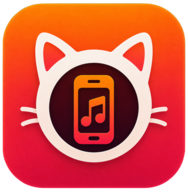
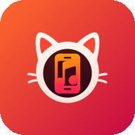

# Michi Music Mobile

<p align="center">
  
</p>

[](LICENSE)
[](https://kotlinlang.org)
[](https://developer.android.com)
[](https://developer.android.com/guide/topics/media/media3)

Android companion app for [Michi Music Player](https://github.com/pitydah/michi-music-mobile) (Linux/KDE).

Sync your music library wirelessly from your desktop and control playback remotely.
<p align="center">
  
</p>

## Features

- **Local playback** — MediaStore reader with ReplayGain (ID3v2/FLAC), ExoPlayer via Media3
- **Michi Sync** — UDP discovery, HTTP registration, track streaming with Range-Request
- **Remote control** — Poll KDE player status, play/pause/next/prev/volume from phone
- **CoverFlow** — DiscreteScrollView carousel matching KDE `coverflow.py` visual constants
- **Android Auto ready** — `MediaLibraryService` with browsable tree (albums, songs, playlists)
- **Glassmorphism UI** — Dark theme (`#090B11`), 14dp radius, accent pink/purple/blue
- **Artist enrichment** — Local-library artists only; explicit MusicBrainz identity, verified Wikipedia biography, and licensed portrait artwork with private offline cache

## Tech Stack

| Layer | Library |
|-------|---------|
| Language | Kotlin 2.0 |
| UI | Jetpack Compose + Material 3 |
| Audio | AndroidX Media3 1.5.1 / ExoPlayer |
| HTTP | OkHttp 4 + Ktor Client |
| Serialization | kotlinx.serialization |
| Async | Coroutines + Flow |
| DI | Koin |
| Cache | Room (SQLite) |
| Carousel | `yarolegovich/DiscreteScrollView` 1.5.1 |

## Modules

- `:app` — Application entry, UI screens, navigation, DI wiring
- `:core` — Shared domain models (Track, Album, Playlist, Sync DTOs)
- `:data` — Room database, MediaStore reader, repositories
- `:player` — Media3 `MediaLibraryService`, custom `RenderersFactory`, ReplayGain `AudioProcessor`
- `:michi-link-client` — Michi Link API v1 client (UDP discovery, Ktor HTTP, pairing, sync, remote control, receivers)

## Screens

| Screen | Description |
|--------|-------------|
| Home | Quick play, shuffle, all tracks list, search bar |
| Library | CoverFlow carousel + album track list |
| Now Playing | Album art, seek bar, queue, play/pause/next/prev |
| Playlist | All tracks indexed list with active-track highlight |
| Remote | KDE remote control with status polling |
| Sync | Discovery, registration, download progress |
| Settings | Server config, auto-sync toggle |

## Artist enrichment and artwork

Artist metadata never adds remote albums to the local collection. The **DISCOGRAFÍA**
section only lists albums whose files exist on this phone.

- **Identity** — MusicBrainz candidates are proposed automatically, but no candidate is
  confirmed by name, not even a single exact match. The user selects the MBID explicitly;
  ambiguous matches require that choice. The app never merges artists by name.
- **One automatic journey** — a confirmed MBID triggers biography, Commons P18/P180,
  Wikipedia PageImages and fallback Openverse discovery without a second search or
  retry button. Bio and artwork fail independently.
- **Biography** — comes from a verified Wikipedia article (direct MusicBrainz relation or
  a verified Wikidata QID sitelink), with its source URL shown.
- **Artwork** — providers only propose images. Commons P18, Commons P180, Wikipedia
  PageImages, and a name-only Openverse/Flickr result must pass license,
  attribution, origin and identity checks before being downloaded. Openverse results
  that cannot be tied to the verified MBID stay as visual-review candidates.
- **Two crops, one file** — a circular thumbnail for the artist mosaic and a hero crop
  inside the existing ficha. Focus is stored per slot; the hero reuses the thumbnail
  only when its resolution is sufficient.
- **Offline cache** — decoded bytes live in app-private storage and are referenced from
  Room. A URL alone is never treated as a saved image, and artwork is never uploaded.
- **Optional providers** — TheAudioDB and Fanart.tv are compiled but disabled (no keys,
  no network); Openverse discovery runs automatically only when verified sources leave
  a slot uncovered. An Openverse/Flickr result never becomes READY until its page's
  schema.org `ImageObject` contains both the exact numeric photo id and the expected
  licence, and the user explicitly chooses it.
- **Durable association** — a confirmed profile stores the album IDs that supported it.
  A later rescan that adds or removes albums recovers the profile only when exactly one
  historical association shares a visible album; ambiguous overlaps are left untouched.

The enrichment cache database (`michi-artist-enrichment.db`) is version 6; migrations
preserve existing profiles, artwork assets, selections, links, focus and licenses
without destructive fallback.

## Build

```bash
export ANDROID_HOME=/path/to/android-sdk
./gradlew assembleNormalDebug
```

APK: `app/build/outputs/apk/normal/debug/app-normal-debug.apk`

For F-Droid release:

```bash
./gradlew assembleFdroidRelease
```

APK: `app/build/outputs/apk/fdroid/release/app-fdroid-release.apk`

Minimum SDK: 31 (Android 12)
Target SDK: 35

## Permissions

| Permission | Purpose |
|-----------|---------|
| `READ_MEDIA_AUDIO` (13+) / `READ_EXTERNAL_STORAGE` (≤12) | Access local music library |
| `INTERNET` | LAN-only communication with desktop server. No external internet required |
| `ACCESS_NETWORK_STATE` | Check connectivity before sync operations |
| `ACCESS_WIFI_STATE`, `CHANGE_WIFI_MULTICAST_STATE` | UDP multicast discovery of desktop server |
| `BLUETOOTH`, `BLUETOOTH_CONNECT` | Detect Bluetooth A2DP audio devices |
| `FOREGROUND_SERVICE`, `FOREGROUND_SERVICE_MEDIA_PLAYBACK` | Background audio playback (Android 14+) |
| `POST_NOTIFICATIONS` | Media playback notification (Android 13+) |
| `WAKE_LOCK` | Keep CPU awake during music sync/download |

Network traffic is restricted to private IP ranges via `network_security_config.xml`.

## License

GPL-3.0-or-later — see [LICENSE](LICENSE) and [NOTICE](NOTICE).

Third-party components listed in [docs/THIRD_PARTY.md](docs/THIRD_PARTY.md).
